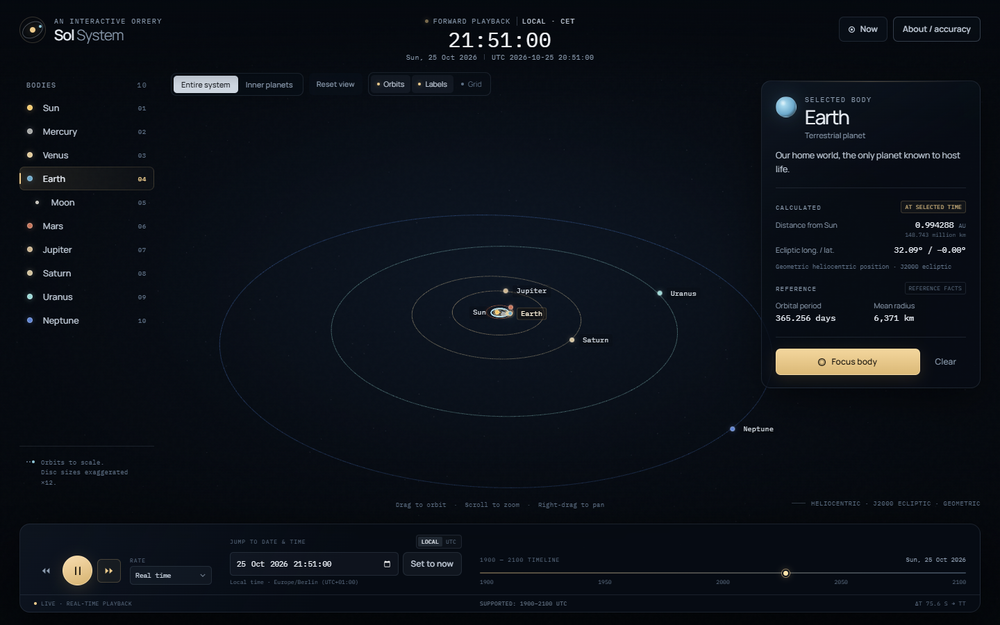
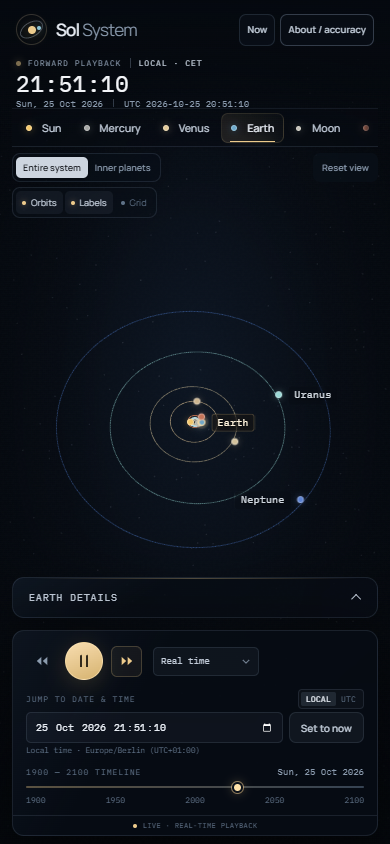
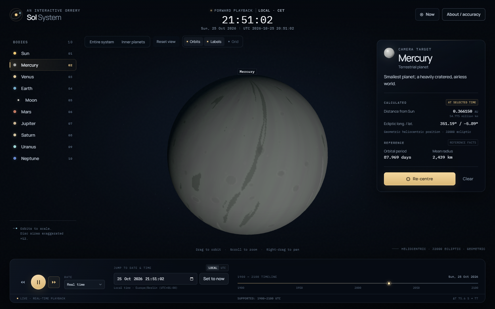
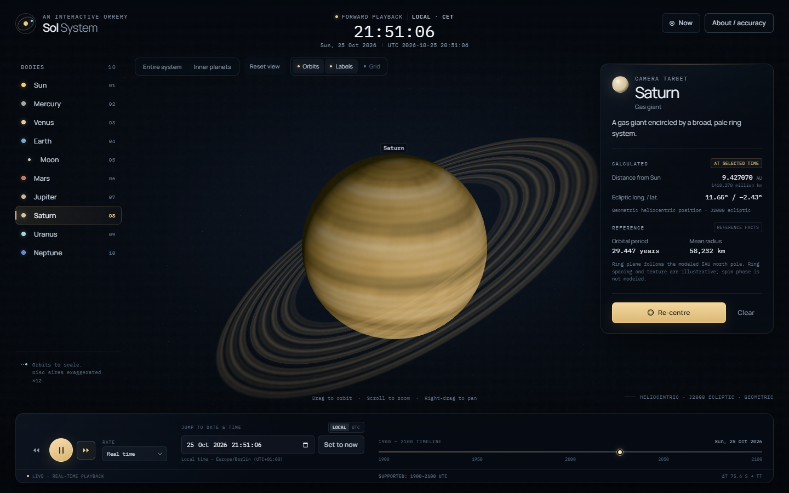

# Sol System — an interactive orrery

A local, ephemeris-driven explorer of the Sun and eight planets at any instant
from **1900-01-01 through 2100-12-31 UTC**. Positions are geometric,
heliocentric vectors in the **J2000 mean ecliptic** frame—not apparent
positions seen from Earth. Distances are physically proportional; planet discs
are deliberately enlarged for visibility and labelled as such.



| Mobile layout | Mercury close-up | Saturn close-up |
| --- | --- | --- |
|  |  |  |

## Run it

No build step, API key, backend, or runtime network connection is required.
All rendering, ephemeris, and font assets are vendored locally.

```powershell
node scripts/serve.mjs
```

Open **http://127.0.0.1:4173**.

`npm start` is equivalent:

```powershell
npm start
```

The optional port argument is supported, for example `node scripts/serve.mjs 8080`.

> **Important:** Clicking `index.html` in a file preview pane opens a `file://`
> URL, and browsers block JavaScript modules there. Use **http://127.0.0.1:4173/**
> after starting the server. The application detects this case and displays a
> direct **Open the local app** link instead of failing silently.

The same static application can be hosted on GitHub Pages or any static host;
all module and asset paths are relative. See the repository URL below.

## Controls

- **Navigate:** drag to rotate, scroll/pinch to zoom, right-drag or two-finger
  drag to pan. Damping makes wheel and trackpad zoom smooth.
- **Select/focus:** click a planet marker or label, or choose a body from the
  left list. The camera eases into a sunlit close-up and then tracks that body
  while time changes. **Clear** removes the selection; **Re-centre** refocuses
  the selected body.
- **View presets:** **Entire system**, **Inner planets**, and **Reset view**
  (Reset returns to the entire system without changing the selected time).
- **Time:** use the date/time field in **Local** or **UTC** entry mode, the
  global **Now** button, or the 1900–2100 timeline scrubber. Manual changes
  pause playback so the chosen instant stays inspectable.
- **Playback:** pause/play, play forwards, play backwards, and rates from
  **real time** through **1 year / sec**. **Now** restores the current computer
  time, real-time rate, forward direction, and playback.
- **Layers:** orbit paths, body labels/minimum markers, and the ecliptic
  reference grid can be toggled independently.
- **Keyboard:** `Space` pause/play, `N` now, `1` entire system, `2` inner
  planets, `0` reset view. Focus the date field for keyboard time entry.
- **About / accuracy** opens the full model, time-scale, precision, source, and
  limitation notes. The same material is summarized below.

The active instant is always displayed at the top; the bottom status line shows
playback rate, the supported UTC interval, and the applied ΔT (TT−UT) in
seconds.

## Scientific model

### Positions

- **Library:** [Astronomy Engine 2.1.19](https://github.com/cosinekitty/astronomy)
  by Don Cross, MIT, vendored at `vendor/astronomy/astronomy.js`.
- **Planets:** Astronomy Engine's VSOP87-based heliocentric geometric vectors
  (`HelioVector`). The library project describes its model as accurate to
  approximately ±1 arcminute and tested against NOVAS and JPL Horizons.
- **Moon:** `GeoMoon` is added to Earth's heliocentric vector to obtain the
  Moon's heliocentric position. The geocentric Earth–Moon distance is shown for
  the Moon.
- **Frame:** Astronomy Engine returns J2000 mean equatorial (EQJ) vectors. This
  app applies the library's `Rotation_EQJ_ECL()` matrix to obtain **J2000 mean
  ecliptic (ECL)** coordinates:
  - +x toward the J2000 equinox,
  - +y 90° eastward in the ecliptic plane,
  - +z toward ecliptic north.
- **Geometric, not apparent:** no light-time correction, aberration, nutation,
  atmospheric refraction, observer location, or Earth-based projection is
  applied. These are positions at the selected instant, centred on the Sun.
- **Orbit paths:** sampled directly with the same `HelioVector`/`GeoMoon` model
  at 288 points over one reference sidereal period. They are polyline
  approximations only in segment density. Near the ends of the supported date
  interval, path samples may extend just outside it so the loop closes; the
  displayed body positions never leave 1900–2100.

### Time

- Browser `Date` values are UTC. The Local/UTC switch only changes how civil
  times are entered and displayed; it never changes the underlying instant.
- Local conversion uses the browser's IANA time zone. Nonexistent local times
  caused by a daylight-saving gap are rejected. An ambiguous repeated local
  time is resolved by the browser's `Date` implementation; use UTC mode when
  unambiguous input matters.
- Leap years follow the proleptic Gregorian calendar built into JavaScript's
  `Date`. Leap seconds are not represented in the civil timestamp.
- Astronomy Engine converts UTC to **Terrestrial Time (TT)** for its VSOP87
  evaluation using the Espenak–Meeus ΔT model. The current applied ΔT is shown
  numerically in the bottom status line.
- The app deliberately restricts selectable instants to **1900-01-01 through
  2100-12-31 UTC**. At the boundaries, playback stops and the picker is limited
  to the same interval. The library itself supports a wider range.

### Simulation time vs rendering

Simulation state is a UTC timestamp plus a real-time anchor:

```text
simulationTime = anchorSimulationTime
               + direction × speed × (performance.now() − anchorPerformanceTime)
```

Each frame, body positions are recomputed from that timestamp through the
astronomy module. Orbits are not animated by accumulated frame deltas, and
positions never depend on frame rate, prior playback, or camera state.

### Scale and visual treatment

- **Orbital distances:** one uniform linear scale, `1 AU = 20` world units.
  No logarithmic distance compression is used.
- **Discs and the Sun:** physical radii are multiplied by a uniform **×12** for
  visibility. Labels and small markers are navigation aids with a minimum
  screen size, not physical sizes.
- **Textures:** generated procedurally in the browser, non-cartographic, and
  illustrative. They are not surface maps or observational imagery.
- **Saturn:** the ring plane is oriented from Astronomy Engine's IAU north-pole
  model for Saturn (`RotationAxis`). Ring spacing, opacity, texture, and spin
  phase are illustrative, not a model of the ring system's optical depth.
- **Other orientations:** axial tilts/spin phases, clouds, surface features, and
  magnetic fields are not modeled. The star field is decorative, not a star
  catalogue.
- **Camera:** adaptive near/far planes plus a logarithmic depth buffer keep
  close-up planets from clipping; focus tracking translates the camera target
  with the body instead of re-centring from scratch.

## Accuracy

### Precision is not accuracy

The interface prints distances to 0.000001 AU and ΔT to 0.1 seconds. Those are
display precision only. Actual accuracy is limited by the truncated VSOP87
model, time-scale approximations, outer-planet ephemeris differences, and the
fact that no light-time or observer corrections are applied. This is a
visualization and educational tool, not navigation software.

### Independent JPL Horizons comparison

I queried NASA/JPL's Horizons API directly for **geometric heliocentric
vectors**, centre `500@10` (Sun body centre), frame **Ecliptic of J2000.0**,
time type **UT**, units **AU**. The reference bodies/time scales therefore match
the implementation's frame and target. The exact source vectors and retrieval
timestamp are stored in [`tests/reference-vectors.json`](tests/reference-vectors.json).

The Horizons sources reported for these targets were DE441 (Earth), `mar099`
(Mars), and `nep098_merged` (Neptune). The 2035 reference uses Horizons' `UT~`
convention, where the last known leap second is held constant; this app uses
the Espenak–Meeus ΔT model.

| UTC instant | Body | Position difference | Approx. angular separation at Sun |
|---|---:|---:|---:|
| 2025-01-01 00:00:00 | Earth | 0.000005860 AU · **877 km** | 1.23″ |
| 2025-01-01 00:00:00 | Mars | 0.000010925 AU · **1,634 km** | 1.40″ |
| 2025-01-01 00:00:00 | Neptune | 0.002261279 AU · **338,282 km** | 15.60″ |
| 2035-07-04 12:00:00 | Earth | 0.000007853 AU · **1,175 km** | 1.59″ |
| 2035-07-04 12:00:00 | Mars | 0.000008891 AU · **1,330 km** | 1.31″ |
| 2035-07-04 12:00:00 | Neptune | 0.001058821 AU · **158,397 km** | 7.32″ |

These observed differences are within Astronomy Engine's approximate
±1 arcminute design claim. They should not be read as a global certification of
the library: only these three bodies at these two epochs were checked here.
Neptune is the least accurate of the three, consistent with the greater
difficulty of modeling its orbit with a truncated series. The angular value is
an approximate angular displacement as seen from the Sun, not an Earth-based
observable.

## Verification performed

### Unit tests

```powershell
npm test
```

13 tests in `tests/astronomy.test.mjs` cover:

- the model's frame, time-scale, and date-range metadata;
- all ten bodies producing finite vectors, with the Sun at the origin;
- Earth, Mars, and Neptune against the retained JPL Horizons vectors;
- pure timestamp determinism across intervening calculations;
- inclusive 1900/2100 boundaries and rejection outside them;
- leap-day handling (2000-02-29);
- plausible ΔT values;
- Earth+Moon vector composition;
- orbit curves agreeing with the position model and remaining useful at the
  upper boundary;
- Saturn's pole as a unit vector;
- UTC/local `datetime-local` parsing, invalid dates, leap day, and range limits.

### Browser end-to-end tests

```powershell
npm run test:e2e
```

The test starts its own local HTTP server and drives installed Chrome or Edge
with `playwright-core`. If Playwright cannot spawn a browser (for example, under
a restricted named-pipe sandbox), attach to an existing Chrome with remote
debugging instead:

```powershell
& "C:\Program Files\Google\Chrome\Application\chrome.exe" `
  --headless=new --remote-debugging-port=9222 `
  --user-data-dir="$PWD\.chrome-profile" --enable-unsafe-swiftshader
$env:CDP_URL = "http://127.0.0.1:9222"
npm run test:e2e
```

(Install test dependencies first with `npm install`; the application itself does
not need them.)

The browser suite verifies 20 checkpoints:

- clean load, WebGL canvas, no console/page errors, no failed resources;
- initial time equals the computer's clock and playback is real-time;
- local/UTC entry conversion and the explicit timezone label;
- leap day through the actual date input;
- Now restoring current time, forward real-time playback, and 1× rate;
- reverse and forward playback, pause, and the full speed menu;
- all three camera presets;
- wheel zoom, drag-to-rotate, and right-drag pan;
- Mercury and Neptune selection, close-up camera distances, adaptive near
  planes, and calculated-distance display;
- camera tracking during playback and across a multi-year date jump;
- supported boundaries and timestamp determinism independent of playback
  history;
- orbit, label, and grid toggles changing real scene objects;
- the timeline scrubber seeking and pausing;
- narrow portrait (390×844) and short landscape (844×390) layouts, including
  no horizontal overflow, visible Reset, non-overlapping panels, and usable
  About/details sheets.

Screenshots are written to `tests/artifacts/`. The curated previews near the
top of this README are in `docs/`.

**Environment actually tested:** Chrome 156 headless on Windows, with software
WebGL via SwiftShader. The test suite did not exercise Firefox or Safari, a
physical touchscreen, a screen reader, or HDR colour displays. Touch gestures
use Three.js `OrbitControls` but are not covered by the automated run.

## Project layout

```text
index.html                 entry point and semantic UI
styles.css                 museum-style visual system and responsive layouts
src/
  astronomy.js             pure ephemeris, frames, time range, orbit sampling
  catalog.js               reference facts and visual metadata
  scene.js                 Three.js scene, textures, camera, labels, picking
  ui.js                    DOM controls, time-zone conversion, formatting
  main.js                  timestamp state, playback anchor, app orchestration
vendor/
  astronomy/               Astronomy Engine 2.1.19 + MIT licence
  three/                   Three.js r186, OrbitControls, Line2 + MIT licence
  fonts/                   locally hosted Manrope and IBM Plex Mono
scripts/
  serve.mjs               simple local HTTP server
  server.mjs              reusable server implementation for tests
tests/
  astronomy.test.mjs       unit + independent reference checks
  e2e.mjs                  Playwright/Chrome end-to-end suite
  reference-vectors.json   retained JPL Horizons baseline
  artifacts/               screenshots produced by the browser suite
```

## Dependencies and licensing

Runtime dependencies are vendored and loaded locally:

- **Astronomy Engine 2.1.19** — MIT.
- **Three.js r186** — MIT, including `OrbitControls` and `Line2` add-ons.
- **Manrope** and **IBM Plex Mono** — SIL Open Font License 1.1.

See [`THIRD_PARTY_NOTICES.md`](THIRD_PARTY_NOTICES.md) and the licence files in
`vendor/`. `playwright-core` is a development-only test dependency. No live
planetary-position API, paid service, API key, or backend is used.

Primary references:

- [Astronomy Engine repository and documentation](https://github.com/cosinekitty/astronomy)
- [NASA/JPL Horizons](https://ssd.jpl.nasa.gov/horizons/)
- [JPL Planetary Physical Parameters](https://ssd.jpl.nasa.gov/planets/phys_par.html)
- [NASA Planetary Fact Sheet](https://nssdc.gsfc.nasa.gov/planetary/factsheet/)

## Known limitations

- VSOP87 truncation means the positions are approximate, and the outer planets
  show larger differences from JPL DE441 than Earth or Mars. The model is not
  suitable for navigation, spacecraft operations, occultations, or precise
  observational planning.
- The Moon uses Astronomy Engine's geocentric lunar model; no other moons,
  asteroids, comets, Pluto, or planetary ring dynamics are included.
- Orbits are sampled polylines, not osculating conic sections, and their visual
  smoothness depends on view scale.
- Surface textures, star field, Saturn's ring bands, and marker sizes are
  illustrative. Axial orientations other than Saturn's ring-plane normal are not
  modeled; rotation phases are intentionally not animated.
- The supported UI interval is 1900–2100 UTC. Horizons' future `UT~` convention,
  unknown future leap seconds, and the ΔT model all contribute uncertainty near
  the future boundary.
- Local-time DST gaps are rejected, but ambiguous repeated local times can only
  be disambiguated by switching to UTC.
- In Local entry mode the picker bounds are the exact UTC endpoints converted
  to the browser zone. Near the end of the range a local label can therefore
  read just after midnight on 1 January 2101 while still representing a UTC
  instant inside 2100. UTC mode shows the exact 1900–2100 bounds.
- Browser testing used Chrome only; Firefox and Safari rendering and touch
  behaviour remain unverified in this workspace.
